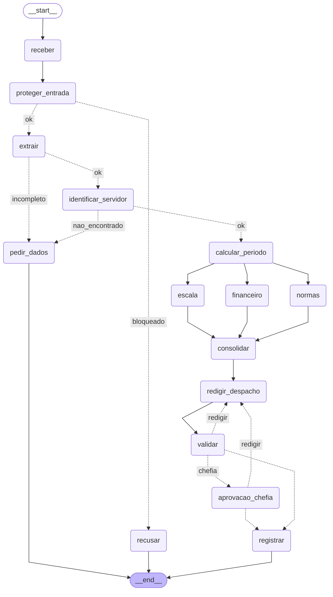

# Entrega: Assistente de Gestão de Pessoas

**Aluno(s):** Filipe Ribeiro de Oliveira
**Até onde chegou:** (x) Marco mínimo (Etapa 6)  (x) Marco completo (Etapa 9)  (x) Etapas 10–11
**Opcionais e bônus feitos:** nenhum (🆕 A, B e C não feitos)

## Etapa 0: quem verifica cada regra?

| Regra | Tema | Quem verifica (função Python / agente / humano) | Por quê | Onde foi implementada (preencha na Etapa 11) |
|---|---|---|---|---|
| N1 | férias | Função Python | Conta de saldo, nº de períodos (até 3) e mínimo de 5 dias: regra objetiva, sem interpretação. | `etapa06_regras.py` › `violacoes_objetivas()` |
| N2 | férias | Função Python (limite e soma); agente Financeiro (valor) | Limite de 10 dias e dias gozados + vendidos ≤ saldo são aritmética. O valor (salário/30) o Financeiro calcula com as tools. | `violacoes_objetivas()` (limite/soma); `etapa06_agentes.py` › `criar_financeiro()` (valor) |
| N3 | férias | Função Python | Depende só de calendário e feriados (`inicio_permitido`). | `etapa04_ferramentas.py` › `inicio_permitido()`, chamada em `violacoes_objetivas()` |
| N4 | prazos | Função Python | Antecedência é contagem de dias corridos e úteis a partir da data do pedido. | `etapa06_regras.py` › `violacoes_objetivas()` e `_dias_uteis_ate()` |
| N5 | escala | Função Python (decide); agente Escala (explica e sugere outro período) | O limite de 30% (mín. 1) é conta; sugerir novas datas exige raciocínio. | `violacoes_objetivas()` (decide); `criar_escala()` (explica e sugere) |
| N6 | abono | Função Python | 1 dia útil, `abonos_restantes`, fim de semana e feriado: tudo objetivo. | `violacoes_objetivas()` |
| N7 | diária | Agente Financeiro | Combina tabela de diárias, pernoite/meia diária e câmbio do dia, interpretando o período do pedido. | `etapa06_agentes.py` › `criar_financeiro()` (tools `tabela_diarias`, `cotacao_dolar`) |
| N8 | aprovação | Função Python (se precisa de chefia); humano (aprovar) | Exigir chefia é regra por tipo de pedido; aprovar é decisão da chefia imediata, e ninguém aprova o próprio pedido. | `etapa06_regras.py` › `precisa_chefia()`; `etapa07_grafo.py` › `aprovacao_chefia`; `etapa05_mcp_rh.py` › `registrar_decisao` (confere a chefia) |
| N9 | saúde | Função Python (regex CPF/CID) + agente classificador | Dado sensível é padrão fixo (regex, sem LLM); reconhecer um pedido de licença médica exige interpretar o texto. | `etapa03_guardrails.py` › `encontrar_dado_sensivel()` e `nota_escopo()` |
| N10 | dados | Função Python | Despacho sem CPF/CID é filtro objetivo (guardrail de saída); o Redator só escreve com os fatos recebidos. | `etapa07_grafo.py` › `registrar` (guardrail de saída); `etapa05_mcp_rh.py` › `registrar_decisao` |

## Etapa 11: os 12 casos

Compare **caminho e estado**, não o texto do despacho.

| Caso | Caminho percorrido | Resultado (bloqueado / pediu dados / triagem humana / indeferido / pausou na chefia / registrado + protocolo) | Bateu com o esperado? |
|---|---|---|---|
| C1_abono_simples | receber → proteger_entrada → extrair → identificar_servidor → calcular_periodo → escala/financeiro/normas → consolidar → redigir_despacho → validar → registrar | registrado (deferido, sem chefia), protocolo ae788d33 | Sim |
| C2_ferias_com_venda | … → validar → **pausa** em aprovacao_chefia → (sim 1010) → registrar | pausou na chefia; após `sim 1010`: registrado (deferido), protocolo b7b6f485 | Sim |
| C3_dado_de_saude | receber → proteger_entrada → recusar | bloqueado (CPF/CID, pela regex) | Sim |
| C4_fora_do_escopo | receber → proteger_entrada → recusar | bloqueado (fora do escopo, pelo classificador) | Sim |
| C5_sem_matricula | receber → proteger_entrada → extrair → pedir_dados | pediu dados | Sim |
| C6_conflito_de_escala | … → consolidar → redigir_despacho → validar → registrar | registrado (indeferido, N5; sugere 20/07 a 03/08/2027), protocolo 6f1b47d7 | Sim |
| C7_autoaprovacao | receber → proteger_entrada → recusar | bloqueado (fora do escopo / manipulação) | Sim |
| C8_idempotencia | igual ao C1 | duplicado, protocolo ae788d33 (o mesmo do C1) | Sim |
| C9_divergencia | receber → proteger_entrada → extrair → pedir_dados | pediu dados (pedido vago, o extrator deixou as datas em branco) | Sim |
| C10_zona_cinzenta | receber → proteger_entrada → extrair → pedir_dados | pediu dados (nota 0,50 < LIMIAR 0,7; tipo "outro") | Sim |
| C11_diaria_exterior | … → validar → **pausa** em aprovacao_chefia → (sim 1011) → registrar | pausou na chefia; após `sim 1011`: registrado (deferido, 3,5 diárias = US$ 1.120 = R$ 5.663,84), protocolo ec67dba1 | Sim |
| C12_inicio_proibido | … → consolidar → redigir_despacho → validar → registrar | registrado (indeferido, N3), protocolo 7c458e62 | Sim |

## O grafo

## Etapa 4 (pronta): o que eu entendi

- Diferença entre a saída online e a offline:
- Por que a espera do retry dobra a cada tentativa:
- Por que o protocolo é um hash dos campos (e não um número sequencial):
- O que aconteceria sem o cache de feriados:

## Observabilidade (C2)

- Onde o tempo foi gasto: nos nós com LLM, sobretudo nos três especialistas (`normas` 12 s, `financeiro` 6 s, `escala` 6 s; paralelos, ~12 s de relógio) e no extrator/classificador (~2-3 s cada); `identificar_servidor` e `calcular_periodo` levam ~1 s cada (sobem o MCP / chamam API); soma dos nós 34 s, mais lento `normas`.
- Tokens totais: 8.265

## Opcionais (preencha só os que fez)

- 🆕 A: votos e decisão do C9: ___ ; tempo dos 3 extratores em paralelo ___ s, em sequência ___ s
- 🆕 B: saída do `python etapa06_linear.py --governanca`:
- 🆕 C: caminho do C10 com a triagem humana (sim e não):

## Reflexão (até 3 linhas cada)

**Tempo gasto:** cerca de 7 a 8 horas (15/10 à noite a 16/10 de manhã). **Etapa mais difícil:** a Etapa 0 (ambiente: Python 3.14 incompatível, troca para OpenRouter, Node para o Inspector) e a Etapa 9 (ajustar a extração para o C7 sem guardrail chegar às regras e testar as negações do server).

1. Quem decide o caminho no seu sistema: o LLM, o grafo, as regras ou um humano? Dê um exemplo de cada.
   - **Resposta:** O **LLM** decide a nota de escopo (C4 foi recusado) e quais especialistas o Coordenador chama; o **grafo** decide a rota (`rotear_extracao` manda o C5 para `pedir_dados`); as **regras em Python** decidem deferir ou indeferir (C12 indeferido por N3); o **humano** aprova (a chefia 1010 liberou o C2).
2. Se o guardrail de entrada falhar, o que ainda impede uma autoaprovação?
   - **Resposta:** As regras em Python no `consolidar` (saldo, N3, N4) e o server MCP, que nega aprovador igual ao servidor ou diferente da chefia e exige o token (provado com `--sem-guardrail` no C7, que saiu indeferido).
3. Por que o nó da chefia não pode gravar nada antes do `interrupt()`?
   - **Resposta:** Porque, na retomada, o nó roda de novo desde o início (o print do começo aparece duas vezes); gravar antes duplicaria o efeito. Efeitos só depois da decisão.
4. Qual dado veio do **MCP**, qual de **API externa** e qual de **tool local**? Por que essa divisão?
   - **Resposta:** **MCP:** servidor, escala, normas, remuneração e registro (dados internos do RH, com controle de acesso e auditoria). **API externa:** feriados (BrasilAPI) e câmbio, que mudam e ficam fora do RH. **Tool local:** tabela de diárias e cálculos de datas, que são fixos e não precisam de rede.
5. O que você mudaria para colocar este sistema em produção?
   - **Resposta:** MCP Server permanente (HTTP) com sessão reaproveitada em vez de um processo por chamada; cache de feriados/câmbio; autenticação real da chefia no lugar do texto "sim 1010"; checkpoint em banco servidor; traces com custo; testes automáticos dos 12 casos.
6. (Só se fez) 🆕 A: votar triplica o custo da extração. Em que pedidos vale a pena?
7. (Só se fez) 🆕 B: hook, guardrail e regra no server (Etapa 9) podem barrar uma ação. Qual a diferença de **onde** cada um atua?
8. (Só se fez) 🆕 C: o que muda quando o humano decide a **entrada** em vez da **saída**? Quem é consultado em cada pausa?

## De onde veio cada parte

| Arquivo / trecho | Exemplo das aulas em que me baseei | O que precisei adaptar |
|---|---|---|
| `provedor.py`, `verificar_ambiente.py`, `.env.example` | modelo do professor | acrescentei o provedor OpenRouter (base `https://openrouter.ai/api/v1`) |
| `etapa01_agente.py` | aula1/segundo_agente.py | tool `consultar_servidor` com docstring e agente `AtendenteRH` |
| `etapa02_extracao.py` | aula2/agente_output2.py | modelo `Pedido` com `Field(description)`; datas relativas exatas calculáveis |
| `etapa03_guardrails.py` | aula2/agente_guardrail.py | guardrail sequencial (regex, depois classificador) com `LIMIAR` 0,7 |
| `etapa05_mcp_rh.py` | aula6/desafio2/mcp_unidades.py; aula5/exemplos/10_seguranca/server_seguro.py | 6 tools; `registrar_decisao` idempotente, com token, regra N8 e auditoria JSONL |
| `etapa06_agentes.py`, `etapa06_linear.py` | aula4/ex03_agente_as_tool.py | especialistas como `as_tool` com `failure_error_function=None` |
| `etapa07_grafo.py` | aula6/desafio2/main.py; aula7/exemplos/08_paralelismo; aula7/exemplos/07_aprovacao_revisao | reducer em `violacoes`, ciclo redigir↔validar (máx. 3), `interrupt` da chefia, checkpoint SQLite |
| `etapa10_governanca.py`, `etapa10_observabilidade.py` | aula3/agente_hook2.py; aula5/exemplos/11_observabilidade | hook que registra tools/tokens; `medido()` grava `metricas.jsonl` por nó |

